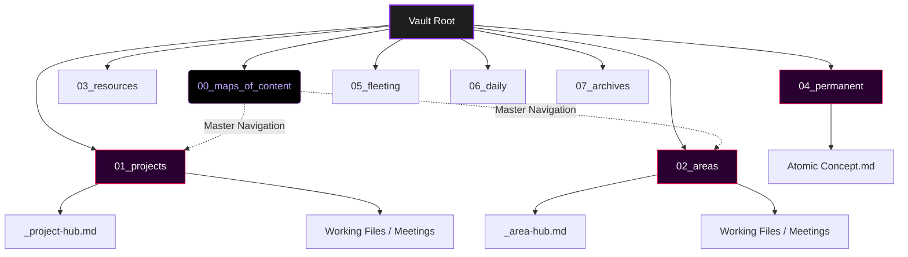
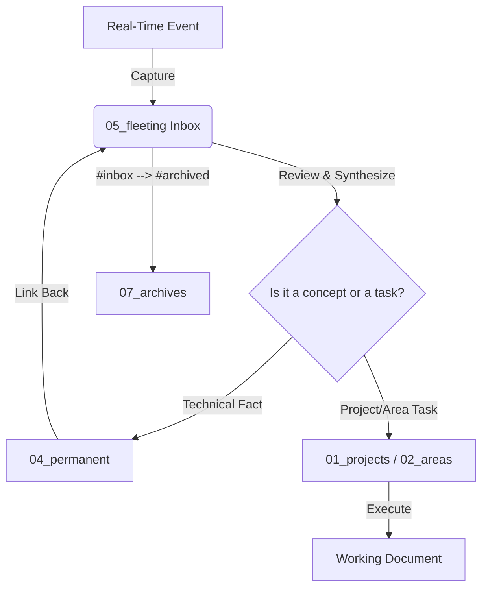

# A. Core Philosophy and Directory Architecture
The vault is configured to operate as a relational database, utilizing a strict fusion of **Zettelkasten** (knowledge processing) and **PARA** (project execution) methodologies.
## 1. Separation of Capture and Synthesis
You must never attempt to organize, format, or perfectly title a note while you actively absorbing information. The cognitive load must be separated in to two phases:

| **Phase**        | **Designation** | **Action**                                                                                         | **Output Location** |
| ---------------- | --------------- | -------------------------------------------------------------------------------------------------- | ------------------- |
| **1. Capture**   | Fleeting Notes  | Real-time, zero-friction logging of events (lectures, sermons, meetings). Formatting is ignored.   | `05_fleeting`       |
| **2. Synthesis** | Permanent Notes | A scheduled, deliberate extraction of atomic facts from fleeting notes, written in your own words. | `04_permanent`      |

## 2. The Definitive Vault Architecture
Vault now relies on strict segregation between **active execution**, **raw storage**, and **permanent knowledge**.

Here is a rigid directory blueprint established:

```text
.
├── 00_maps_of_content
│   └── Dashboard.md                 <-- Master entry point: Eisenhower Matrix & Navigation Links.
├── 01_projects
│   ├── hackvidia_10.0               <-- Folder for a complex project or major CTF.
│   │   ├── _hackvidia_hub.md        <-- Project dashboard (uses Project Template).
│   │   ├── meetings                 <-- Localized meeting logs for this project only.
│   │   └── api_architecture.md      <-- Standard, untemplated working note.
│   └── tryhackme_dogcat.md          <-- Single note for simple, isolated tasks.
├── 02_areas
│   ├── committee_work
│   │   └── ara_7.0                  <-- Folder for ongoing domain responsibility.
│   │       ├── _ara_hub.md          <-- Area dashboard.
│   │       └── meetings             <-- Localized committee meeting logs.
│   └── university_its
│       └── semester_3               <-- Maintained physical folders for easy archiving.
│           └── database_system
│               ├── _db_sys_hub.md
│               └── evaluation_rubric.md
├── 03_resources
│   └── ghidra_documentation.md      <-- Literature notes ABOUT external resources, not the heavy PDFs themselves.
├── 04_permanent
│   ├── _cysec_hub.md                <-- Conceptual index/MoC linking related atomic notes.
│   ├── OSI layer 7 handles user-facing protocols.md     <-- FLAT DIRECTORY. No subfolders here.
│   └── Disassembly converts machine code to assembly.md <-- Atomic, synthesized concept.
├── 05_fleeting
│   └── 2026-03-22-0900 - Random shower thought.md       <-- The universal inbox.
├── 06_daily
│   └── 2026-03-22.md                <-- Triggered manually ONLY when needed for tracking/scratchpad.
├── 07_archives
│   ├── 01_projects_done             <-- Drag-and-drop cold storage for completed projects.
│   ├── 02_areas_retired             <-- Cold storage for finished semesters/committees.
│   └── 05_fleeting_logs             <-- Preserved event logs (sermons, lectures) after synthesis.
└── 99_meta
    ├── assets                       <-- Images, PDFs, local attachments.
    └── templates                    <-- Templater markdown files.
```



## 3. Defining the Note Types by Location

| **If the information is...**        | **It belongs in...** | **Required Action / Template**                                               |
| ----------------------------------- | -------------------- | ---------------------------------------------------------------------------- |
| **An active software build/CTF**    | `01_projects`        | Use a **Project Hub** to track it. Create **blank notes** for working files. |
| **An ongoing responsibility/class** | `02_areas`           | Use an **Area Hub** to track it. Create **blank notes** for working files.   |
| **External media/literature**       | `03_resources`       | Use the **Resource** Template. Summarize the creator's thoughts.             |
| **A timeless, atomic fact/concept** | `04_permanent`       | Use the **Concept Note** Template. Flat directory; rely on linking.          |
| **An immediate event (right now)**  | `05_fleeting`        | Use the **Universal or Sermon Capture** Template.                            |

---

# B. Tools and Integrations

## 1. Master Template List
Templates are strictly reserved files that require standardized YAML metadata for Dataview querying. Do not use templates for standard working documents.

| **Template Name**     | **Purpose**                                           | **When to Use**                                                                               |
| --------------------- | ----------------------------------------------------- | --------------------------------------------------------------------------------------------- |
| **Universal Capture** | Frictionless raw input.                               | During university lectures, rapid thoughts, or meetings.                                      |
| **Sermon Capture**    | Capturing spiritual notes.                            | During church services (includes specific pastor/scripture fields).                           |
| **Project Hub**       | Tracking a software build or CTF.                     | When initiating a new project in `01_projects`.                                               |
| **Area Hub**          | Tracking a domain or university class.                | When creating a new semester class or committee in `02_areas`.                                |
| **Concept Note**      | Storing isolated knowledge.                           | When synthesizing a technical fact into `04_permanent`.                                       |
| **Concept Hub**       | Storing links to concept notes with the same domains. | When establishing a new knowledge domain inside `04_permanent` to group related atomic notes. |
| **Resource Note**     | Logging external content.                             | When taking notes on a book, video, or documentation.                                         |
| **Daily Journal**     | Short-term scratchpad & tasks.                        | Manually generated in `06_daily` only on days it is needed.                                   |

## 2. Automation: Linter & Timestamps
**Rule**: Never put `date_created` or `date_modified` values directly into Templater configurations.
- **Execution:** Leave the keys blank in your templates (e.g., `date_created:` ). The Obsidian Linter plugin will automatically inject and update timestamps in the background upon file creation and saving.
## 3. Excalidraw Integration (Visual Notes)
Excalidraw files (`.excalidraw.md`) are treated as native markdown files, not external images
- **Workflow:** Store them directly in the relevant Area, Project, or Permanent folder.
- **Metadata:** Press `Ctrl+P` -> `Excalidraw: Toggle between Excalidraw and Markdown mode` to add standard YAML tags to a drawing so Dataview can index it.
- **Embedding:** Embed drawings directly into your Hubs (`![[Drawing Name.excalidraw]]`) to create visual dashboards.

---

# C. Database Schema and Naming Conventions
This section primarily covers the strict, mechanical rules of how data is formatted and how it physically moves through the architecture we established above.
## 1. The tagging Schema (Status vs. Domain)
Tags are never used as folders. They are used for intersectional database queries.

| **Tag Type**             | **Examples**                                | **Definition**                                                   |
| ------------------------ | ------------------------------------------- | ---------------------------------------------------------------- |
| **Status (Operational)** | `#inbox`, `#wip`, `#permanent`, `#archived` | Tells you exactly where the note is in its processing lifecycle. |
| **Domain (Categorical)** | `#cybersec`, `#dev`, `#university`          | Broad subject identifiers that span the entire vault.            |
|                          |                                             |                                                                  |

## 2. Standardized Naming Conventions
File titles are dictated entirely by their phase and type.

| **Note Type**      | **Title Format**                   | **Example**                                       |
| ------------------ | ---------------------------------- | ------------------------------------------------- |
| **Fleeting Notes** | `YYYY-MM-DD-HHmm - Topic`          | `2026-03-22-0900 - Data Communication Lecture`    |
| **Concept Notes**  | `[Concept] [Action/Fact] [Detail]` | `SQL Injection relies on unsanitized user inputs` |
| **Meetings**       | `YYYY-MM-DD - [Context]`           | `2026-03-24 - Full Stack Team Sync`               |
| **Working Files**  | `[Title Case Descriptive Name]`    | `Junior Lab Assistant Evaluation Rubric`          |
| **Resources**      | `[Title] - [Author/Creator]`       | `Black Hat Python - Justin Seitz`                 |
| **Concept Hubs**   | `_[domain]_hub`                    | `cybersec_hub`                                    |

## 3. YAML Frontmatter Schemas
Metadata fields must serve a structural or querying purpose.
- **Concept Notes**:
	- `aliases: [Shorthand, Acronyms]`
    - `tags: [#permanent, #domain]`
    - `up: [[Parent Hub or Concept]]`
    - `related: [[Lateral Concepts]]`
- **Concept Hubs**:
	- `type: concept-hub`
	- `domain: "#domain_name"`
	- `tags: [concept-hub, domain_name]`
- **Fleeting / Event Notes (e.g., Sermons, Lecture)**:
	- `tags: [#inbox, #domain]`
    - `event` / `service_type`: The specific instance.
    - `speaker` / `pastor`: The person delivering the information.
- **Project Hubs:
	- `type: project`
    - `status: [backlog, in-progress, testing, on-hold, completed, cancelled]`.
    - `tech_stack: [React, Node.js, Docker, etc.]`
    - `repo_url`: Link to the repository.
    - `cssclasses: head-center`
- **Resource Notes**:
	- `type: resource`
	- `status: [to-read, reading, finished]`
	- `author: [Name, of, the, Author]`
	- `url: [Link to the source material] `
- **Area Hubs**: 
	- `type: area-hub`
	- `cssclasses: head-center`

---

# D. The Note Lifecycle (The Execution Workflow)
This is the chronological pipeline of how you actually use the vault day-to-day. Information enters, get processed, and gets archived.



## Step 1: Real-Time Capture (The Input)
You are in a class or meeting, you hit your shortcut, a note is created in `05_fleeting` with the Universal Capture or Sermon template. You brain-dump the raw information into the bullet points. You **do not worry about formatting, folders, or declarative titles**.
## Step 2: The Distillation Process (The Output)
Schedule time to open your `#inbox`.
- **If it contains a technical fact** (e.g., how the OSI model works), you extract that single fact into a new, separate **Permanent Note** in `04_permanent`.
- **If it contains assignment requirements**, you open `02_areas` folder and create an untemplated working document for that assignment.
## Step 3: Linking (The Network)
Inside your new Permanent Note, you add a link back to the original fleeting log (e.g., `Source: [[2026-3-22-0900 - Data Communication Lecture]]`). You also link it "up" to the relevant Map of Content (e.g., `[[_jarkom_hub]]`).
## Step 4: The Cleanup (The Archive)
The fleeting note has now been fully processed. You remove the `#inbox` tag. You drag that timestamped log into `07_archives`.

---

# E. Task Configuration
There are task queries to make task and time management way easier using Dataview. Here are some interesting Dataview queries for task management that needs to be remembered.
## Sorting Priority Order
Here is the **full sorting priority order**.

```md
TASK
FROM "testing.md"
SORT choice(due, 1, 2) ASC,
	due ASC,
	contains(tags, "#important") DESC,
	 choice(contains(text, "🔺"), 1, choice(contains(text, "⏫"), 2, choice(contains(text, "🔼"), 3, choice(contains(text, "🔽"), 4, choice(contains(text, "⏬"), 5, 6))))) ASC,
	choice(created, 1, 2) ASC,
	created ASC
```

### 1. There is a due date
`choice(due, 1, 2) ASC
### 2. The closest due is the most top
`due ASC`
### 3. `#important` tag is on top
`contains(tag, #important) DESC`
### 4. Priority levels

```markdown
choice(contains(text, "🔺"), 1, choice(contains(text, "⏫"), 2, choice(contains(text, "🔼"), 3, choice(contains(text, "🔽"), 4, choice(contains(text, "⏬"), 5, 6))))) ASC
```

- Highest priority = the most top
- Lowest Priority = the most under
### 5. There is a created date
`choice(created, 1, 2) ASC`
### 6. The oldest created date is the most top
`created ASC`

---

# F. Excalidraw Configuration

Most people use Excalidraw incorrectly by treating it like Microsoft Paint—drawing a picture, exporting it as a `.png`, and pasting it into a note. That destroys the relational power of the plugin.

Excalidraw files in Obsidian are not image files; **they are literal Markdown files** (`.excalidraw.md`) that render as a canvas. This means they can contain YAML, tags, and bi-directional links exactly like your Concept Notes.

Here is your definitive operating procedure for visual synthesis.

## 1. When and Why to Use Excalidraw
Do not use Excalidraw for taking notes. Use it for **spatial synthesis and architectural mapping**.
- **State Machines / Flowcharts:** Mapping out how a piece of malware traverses a network.
- **Database Schemas:** Drawing the relational tables for a software project.
- **Visual Maps of Content (MoC):** Creating a visual dashboard where you physically draw lines between your different Concept Hubs, turning your `00_maps_of_content` into an actual, clickable map.
- **Wireframes:** Sketching a UI layout for a project.

## 2. Where to Store the Files
Because they are native Markdown files, **do not** put them in your `99_meta/assets` folder. They are first-class citizens in your database. Store them directly in the folder they serve:
- **If it maps a specific software build:** Store it in `01_projects/your_project`.
- **If it maps an ongoing domain:** Store it in `02_areas/your_area`.
- **If it is a timeless diagram of a technical concept (e.g., the OSI Model):** Store it flat in `04_permanent`.

## 3. The Template Strategy (Yes, you need one)
You should not use a Templater script for Excalidraw. Instead, the plugin has its own native template engine.

You need to create a master Excalidraw template that automatically injects a YAML frontmatter block so Dataview can track your drawings just like your notes.

**How to set it up:**
1. Create a new folder: `99_meta/excalidraw_templates`.
2. Create a new Excalidraw drawing inside it and name it `Template_Canvas.excalidraw.md`.
3. Press `Ctrl+P` (or Cmd+P) and search for `Excalidraw: Toggle between Excalidraw and Markdown mode`.
4. At the very top of the raw markdown text, paste your standard YAML schema:

    ```YAML
    ---
    tags: 
      - drawing
    up: []
    related: []
    date_created: 
    date_modified: 
    ---
    ```

5. Toggle back to the drawing mode. You can set a dark background color or change the default font to a monospace coding font if you prefer.
6. Go to **Settings > Excalidraw > Template and Equation Settings** and set the "Excalidraw template file" path to that exact file.

Every time you create a new drawing, it will now be born as a searchable, linkable node in your Zettelkasten.

## 4. The Daily Workflow (The Embedding Superpower)
The true power of Excalidraw is live embedding. You should rarely open the `.excalidraw.md` file itself once it is drawn.
1. **Draw it:** Create `Database_Architecture.excalidraw.md` inside your `01_projects` folder and draw your schema.
2. **Embed it:** Open your `_project_hub.md`. Under your `## Architecture & Environment` header, type `![[Database_Architecture.excalidraw.md]]`.
3. **The Result:** The drawing renders seamlessly inside your Hub note. If you ever need to change the schema, you simply click the embedded drawing, update the box, and it instantly updates everywhere in your vault.

This turns your text-heavy Obsidian vault into a visual engineering notebook.

Would you like to review how to use Excalidraw's "link injection" feature, where you can make individual shapes on the canvas clickable so they open your specific Concept Notes?

---

# G. Coding Notes
## Part 2: The "How" (The Anatomy of a Code Note)
When you write a Permanent Note about a coding concept, it must follow a strict, logical hierarchy. If you look at this note six months from now, you should be able to instantly copy the code and understand exactly why it works without re-reading the entire file.

Here is the exact template structure you should enforce inside your permanent code notes:

### 1. The Conceptual Definition (The "Why")
Never start a note with a code block. Start with plain English. Explain exactly what this code does, why it exists, and what problem it solves. If you cannot explain the code in plain text, you do not actually understand the code yet.

### 2. The Abstract Syntax (The Skeleton)
Before providing a highly specific, complex example, write out the bare-minimum syntax. Use placeholders so your brain understands the mathematical shape of the command.

Python

```
# The basic shape of a Python dictionary comprehension
{key_expression: value_expression for item in iterable if condition}
```

### 3. The Concrete Implementation (The "How")
Now, provide the actual, working code block.

- **Crucial Step:** You must aggressively comment the code _inside_ the code block. Do not rely on paragraph text below the block to explain line 14. Write the explanation on line 14 itself.
- **Syntax Highlighting:** Always declare the language next to your backticks (e.g., `javascript` ) so Obsidian renders the exact colors for that language.

```javascript
// Concrete Example: Fetching user data with async/await
async function getUser(userId) {
    try {
        // Await pauses execution until the promise resolves
        const response = await fetch(`https://api.example.com/users/${userId}`);
        
        // Trap non-200 HTTP responses
        if (!response.ok) throw new Error('Network response was not ok');
        
        return await response.json(); 
    } catch (error) {
        // Failsafe execution
        console.error("Fetch failed:", error);
    }
}
```

### 4. Edge Cases & Gotchas (The "Danger Zone")
The most valuable part of a code note is not the code itself; it is the record of how the code breaks. Document the exact errors you encountered while learning it. If a specific function crashes when passed a `null` variable, write that down explicitly in a `> [!warning]` callout.

---

## The Workflow Execution
1. **You learn something new:** Run your `script_resource_note.md`. Dump everything in there.
2. **You understand it:** Run your `script_permanent_note.md`. Title it the exact name of the specific coding mechanism (e.g., `CSS Grid Template Areas`).
3. **You build the hierarchy:** Link the concept `up` to a parent domain (e.g., `[[_frontend_hub]]`), and link it laterally to related concepts (e.g., `[[CSS Flexbox]]`).

