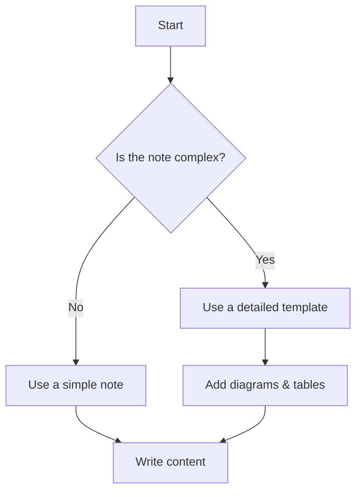
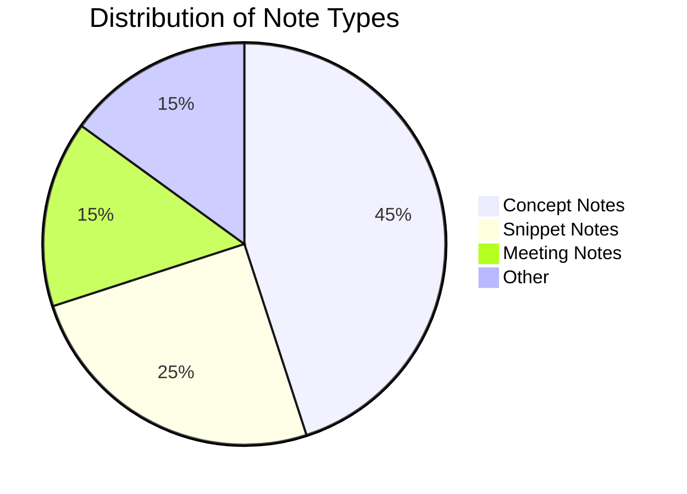

# 🎨 Markdown Elements Library

> This document is a reference library for creating beautiful, consistent, and functional notes. All elements here are compatible with both **GitHub** and advanced previewers like **Markdown Preview Enhanced**.

---

## 🖼️ Banners & Badges

Badges are great for titles and metadata. They are created using `img.shields.io`.

### Standard Badge

<div align="center">
  
</div>

```markdown
<div align="center">
  
</div>
```

### Custom Logo Badge (Using Base64 SVG)

<div align="center">
  
</div>

```markdown
<!-- To create a custom logo, paste your Base64-encoded SVG after "logo=". -->
<div align="center">
  
</div>
```

---

## 🗣️ Call-outs / Admonitions

Use blockquotes with emojis to draw attention to key information.

> 📝 **Note**
> For neutral, supplementary information that is good to know.

> 💡 **Tip**
> For helpful advice, hints, or shortcuts that make a task easier.

> ℹ️ **Info**
> A general-purpose block for providing extra context or links.

> ⚠️ **Warning**
> For actions that could have negative consequences or lead to dead ends.

> 🛑 **Danger**
> For actions that are very likely to cause serious problems, like data loss or system crashes.

---

## 📊 Tables

A well-formatted table is essential for organizing data.

| Feature                 | Status          | Supported On  |
| :---------------------- | :-------------- | :------------ |
| **Basic Formatting**    | ✅ Supported    | All Platforms |
| **Mermaid Diagrams**    | ✅ Supported    | GitHub, MPE   |
| **Admonitions (`!!!`)** | ❌ Incompatible | MPE Only      |

---

## 🙈 Spoilers / Collapsible Sections

Use `<details>` and `<summary>` to hide long code blocks, terminal output, or flags.

<details>
<summary>Click to reveal long log output</summary>

```bash
Log entry 1...
Log entry 2...
Log entry 3...
```

</details>

---

## ✅ Interactive Elements

### Task Lists

Great for tracking steps or requirements.

- [x] Design the template structure.
- [x] Ensure GitHub compatibility.
- [ ] Add more advanced examples.

### Keyboard Keys

Use `<kbd>` to format keyboard keys for a professional look.

Press <kbd>Ctrl</kbd> + <kbd>Shift</kbd> + <kbd>P</kbd> to open the Command Palette.

---

## 📈 Diagrams & Visualizations

Use Mermaid to create diagrams that render on both GitHub and in your local previewer.

### Flowchart



### Pie Chart



---

## ✍️ Text Formatting

### Highlighting Text

Use backticks for `inline code` or double equals `==text==` for highlighting (MPE only, shows as plain text on GitHub).

### Image Sizing & Alignment

Use HTML `` tags for more control over images.

<div align="center">
  
</div>

```markdown
<div align="center">
  
</div>
```